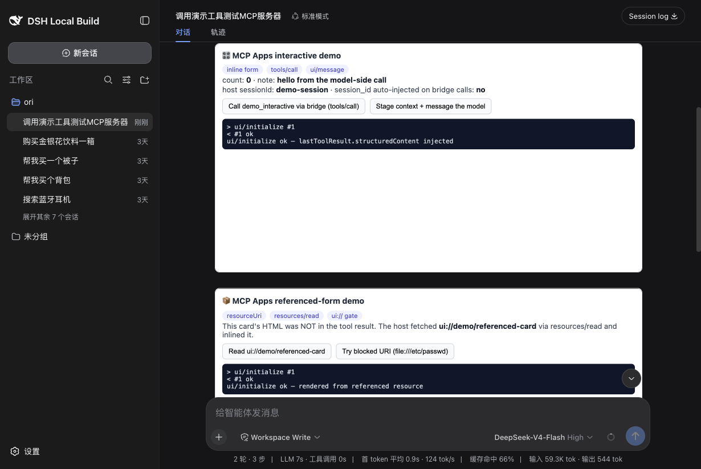

# DSH MCP Apps Host

MCP Apps Host plugin for [DeepSeek Harness](https://github.com/deepseek-ai/deepseek-harness). Connects to an MCP server that declares the `io.modelcontextprotocol/ui` extension, preserves `_meta.ui` in tool results, renders interactive HTML cards in sandboxed iframes, and bridges `postMessage` between cards and the MCP server.

## Features

- **Tool discovery with `_meta` preservation** — MCP tools registered with full `_meta.ui` payloads intact
- **Interactive HTML cards** — sandboxed iframe rendering with per-card CSP
- **postMessage bridge** — `ui/initialize`, `tools/call`, `resources/read`, `ui/update-model-context`, `ui/message`
- **Session ID injection** — automatically injects `session_id` into card-initiated `tools/call`
- **Invisible context injection** — `ui/update-model-context` context injected as a plugin-sourced message via `agent.inject()`, classified as a collapsed context row (not a visible user message bubble)
- **HTTP bridge endpoint** — `/mcp-apps/<serverName>/bridge` for secure iframe-to-MCP-server proxying
- **Multi-instance safe** — each plugin instance registers its own per-server bridge route, so several MCP Apps servers can coexist in one DSH profile
- **stdio + streamable-http** — supports both MCP transport types

## Demo

What a tool result carrying an embedded card looks like in the conversation:



The screenshot shows both cards of the bundled demo server ([`demo/server.mjs`](demo/server.mjs) — zero dependencies, Node stdio only):

- `demo_interactive` (**inline form**): the tool *result* carries `_meta.ui.resource.text`, so the card HTML rides the result. Its buttons exercise the full bridge round trip: a `tools/call` that refreshes the card (the host auto-injects `session_id`), and `ui/update-model-context` + `ui/message` talking back to the model.
- `demo_referenced` (**referenced form**): the tool *definition* carries `_meta.ui.resourceUri` (`ui://demo/referenced-card`); the host resolves the HTML once via `resources/read` and inlines it. The card also demonstrates the bridge's `ui://` security gate — a `file:///etc/passwd` read is refused.

Try it:

```bash
# Protocol-level self-check: spawns the demo server over stdio and asserts
# the handshake, both card forms, session_id echo, and the ui:// resource
# table (8 checks, no DSH needed).
node demo/selftest.mjs

# Full E2E: launch dsh web with the demo overlay, then ask the model to call
# demo_interactive and demo_referenced. Run from the PARENT directory of this
# repo (the overlay's server path is cwd-relative); or adjust the !!js path in
# the overlay to your layout.
dsh web --patch dsh-mcp-apps-host/demo/mcp-apps-demo.cordis.yml
```

## Install

Not on npm yet — install from GitHub. The DSH host provides all `@deepseek-ai/dsh-*` peer packages at runtime, so no peer install is needed:

```bash
npm install github:oriliz/dsh-mcp-apps-host
```

### From source

All dsh peer packages resolve inside the [deepseek-harness](https://github.com/deepseek-ai/deepseek-harness) pnpm workspace, so build there (this also matches the layout the bundled `lib/` was built in):

```bash
git clone https://github.com/deepseek-ai/deepseek-harness.git
cd deepseek-harness
git clone https://github.com/oriliz/dsh-mcp-apps-host.git packages/mcp/mcp-apps-host
pnpm install
npx tsc -b packages/mcp/mcp-apps-host
pnpm --filter @deepseek-ai/dsh-mcp-apps-host bundle
```

## Usage

### 1. Configure the connection

Declare one plugin instance per MCP Apps server in your overlay (`serverName` picks both the tool prefix `mcp__<serverName>__*` and the bridge path `/mcp-apps/<serverName>/bridge`). A ready-to-edit template ships in [`examples/connect-server.patch.yml`](examples/connect-server.patch.yml):

```yaml
- insert:
    - id: mcp-apps-host-my-server
      name: '@deepseek-ai/dsh-mcp-apps-host'
      config:
        transport: stdio
        serverName: my-server
        command: my-apps-server
        args: []
        env: {}
        cwd: ''
        toolCallTimeoutMs: 60000
```

`transport: streamable-http` with a `url` field is also supported.

### 2. Start DSH

```bash
dsh --profile web --patch ./examples/connect-server.patch.yml
```

### 3. Verify

Ask the agent to call one of your server's tools. The tool result renders as an interactive card inside the conversation instead of a plain result row — and the card's own buttons reach back to your server through the bridge (`tools/call`, `resources/read`, `ui/message`). No server at hand? Use the bundled [demo](#demo) first.

## Architecture


Tool results flow left to right (server → tool registry → conversation → card), and card interactions loop back through the HTTP bridge to the server. Card HTML never enters the model context, and the bridge only lets the iframe call tools registered on that server and read `ui://` resources.

## Files

| File | Role |
|------|------|
| `src/index.ts` | Server-side: MCP connection, tool registration, HTTP bridge |
| `src/client/McpAppCard.tsx` | Card component: iframe, postMessage handling |
| `src/client/index.ts` | Client plugin: slot registration, sendUserMessage |
| `src/invariant.ts` | Cordis companion (no runtime invariant) |
| `demo/` | Zero-dependency demo server + protocol self-test + overlay |
| `examples/` | Connection overlay template |

## Development

```bash
# Build
npx tsc -b packages/mcp/mcp-apps-host/tsconfig.json
pnpm --filter @deepseek-ai/dsh-mcp-apps-host bundle

# Run DSH with the plugin
dsh --profile web --patch ./examples/connect-server.patch.yml --port 8089
```

## Pitfalls Fixed

| # | Issue | Fix |
|---|-------|-----|
| P0 | Server strips `_meta.ui` | Declare `mimeTypes` in client capabilities |
| P1 | Card renders but shows no tool data | `presentationMeta()` wraps result as `CallToolResult`-shaped object |
| P2 | `session_id` injection fails | `readSessionId()` prefers `meta.lastToolResult.structuredContent` |
| P3 | External images blocked by CSP | `buildCsp()` adds `https:` to default `img-src` |
| P4 | `ui/update-model-context` was TODO | `_stagedContext` Map stores and prepends context |
| P5 | Context visible as user message text | `ui/inject-context` bridge injects via `agent.inject()` as plugin-sourced message |

See [FINDINGS.md](./FINDINGS.md) for detailed root cause analysis.

## License

MIT
